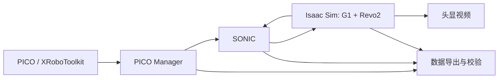

# Supermarket_Issac_capture

用 PICO / XRoboToolkit 遥操作 G1 + Revo2，在 Isaac Sim 超市场景中采集 SONIC 训练数据。

本仓库包含采集代码、固定版本的配置清单、SONIC 集成补丁和安装脚本。**不包含采集数据、视频、模型权重、USD 场景、虚拟环境或安装包。** 大资源从各自上游获取，并按提交与哈希校验。



## 功能与范围

- 批量采集：一条保存后恢复机器人、篮子和场景初态，重建控制器历史。
- 独立 uv 环境，仿真使用 Python 3.11，PICO Manager 使用 Python 3.10。
- 记录 64 维 SONIC motion token、29 关节状态与控制、手部和人体参考、相机帧及时间戳。
- 输出 Parquet、视频和七份元数据；发布前校验文件、字段、帧数和统计。
- 自由基座、显式 PD、200 Hz 仿真时间步与 50 Hz 策略控制。相机原生 25 FPS，数据集对齐到 50 Hz，部分视频帧会复用。
- 正式数据保存到 `outputs/collected_data/`，不覆盖已有成功条目。

当前任务是 **take the basket to the shelf**。机器人初始位置 `(6.338, 4.949999809265137, 0.792)` m、yaw 180°；篮子位置 `(5.786229734718799, 4.949999809265137, 0.9616873861523345)` m、yaw 90°。这些值来自固定上游初态，不由安装脚本重新调高或调姿态。

## 环境

| 部分 | 固定版本 / 要求 |
| --- | --- |
| 系统 | Linux x86_64；开发验证环境 Ubuntu 24.04 |
| 仿真 | Isaac Sim 5.1.0.0；Isaac Lab 2.3.2 / Python 包 0.54.2 |
| 仿真 Python | uv 管理的 Python 3.11 |
| PyTorch | 2.7.0 / CUDA 12.8 wheels |
| SONIC C++ | TensorRT 10.13（x86_64），兼容的 CUDA Toolkit / 驱动 |
| PICO 输入 | XRoboToolkit PC Service 与头显客户端；人体追踪及 Send 开启 |
| 工具 | Git、Git LFS、uv、FFmpeg、patchelf、CMake、C++ 编译工具链 |

Isaac Sim 和模型依赖体积较大，需要独立下载空间和支持 RTX 的 NVIDIA GPU。实际吞吐取决于硬件；配置频率不等于保证达到实时频率。

## 安装

完整依赖、C++ 构建和许可证前提见 [安装说明](docs/installation.md)。从本仓库目录执行：

```bash
git clone https://github.com/KeXiann/Supermarket_Issac_capture.git
cd Supermarket_Issac_capture

# 可选：指定一个独立 SONIC checkout；默认在本仓库旁边。
export SONIC_ROOT="$(dirname "$PWD")/GR00T-WholeBodyControl"

bash setup.sh sources  # 固定版本源码、Git LFS 资产、SONIC 补丁
bash setup.sh runtime  # 独立 uv 仿真环境及 DDS 库校验
bash setup.sh assets   # 校验初态/机器人，生成本机 USD 场景入口
bash setup.sh teleop   # 独立 uv PICO Manager 环境
bash setup.sh video    # 独立 uv 头显视频环境
```

随后按安装说明获取 SONIC **original release** 模型，并编译已打补丁的 C++ 控制器。现有 SONIC checkout 若提交不符，脚本会停止，不会重置或覆盖它。

## 采集

```bash
# 终端一：PICO 画面服务
bash capture.sh video

# 终端二：批量采集（无电脑端窗口）
PICO_HEADLESS=1 bash capture.sh batch
# 需要电脑端仿真窗口时，改为 PICO_HEADLESS=0。
```

头显的 **Data & Control / Send** 和 **Remote Vision / ZEDMINI / Listen** 都应连接电脑当前 IP。视频正常不代表人体数据正常。操作步骤：

1. 等 `WAITING_FOR_CALIBRATION`，保持中立预备姿态，按 ABXY 标定。
2. 松开按键，按 A+X 进入 POSE，等 `[PERF] READY`。
3. 左侧握键 + A 开始；再次按下停止并保存。左侧握键 + B 丢弃。
4. 等 `[BATCH] SAVED` 和下一条初态复位完成，再重新标定。
5. Ctrl+C 或 `bash capture.sh stop` 结束整批；等待 `[BATCH] EXITED`。

更多操作、等待状态和恢复方法见 [采集与数据说明](docs/capture.md)。`READY` 只检查指定窗口内的吞吐与预备姿态，不代表抓取成功或训练质量合格。

## 输出

```text
outputs/collected_data/
├── take_the_basket_to_the_shelf_0/
│   ├── data/chunk-000/episode_000000.parquet
│   ├── videos/chunk-000/observation.images.ego_view/episode_000000.mp4
│   └── meta/  # info、modality、tasks、episodes、episodes_stats、stats、relative_stats
├── .capture_work/  # 未完成 / 待恢复的采集，勿按成功样本使用
├── latest_pico_run.txt
└── latest_mentor_sample.txt
```

任务编号单调增加，失败或丢弃的编号不会复用。数据标准固定来源在 `configs/upstream_manifest.json`，安装后模板位于 `configs/data_standard/meta/`。

## 仓库结构

```text
capture.sh / setup.sh   两个日常入口
bridge/                采集、同步、导出和运行时内部模块
scripts/               依赖获取、安装和内部启动脚本
configs/               小型版本/哈希清单；大资产与生成配置不入 Git
patches/               固定 SONIC 提交的最小集成补丁
assets/collection_reference_2609/  带来源与许可证的小型格式兼容代码
tests/                 控制、时钟、数据合同、退出清理等回归测试
docs/                  安装和使用说明
```

## 检查

轻量测试不需要 GPU 或场景资产：

```bash
uv run --no-project --python 3.11 --with numpy python scripts/test_core.py
```

完成安装后运行完整测试：

```bash
PYTHONPATH="$PWD/bridge:$PWD" .venv/bin/python \
  assets/upstream/7e5fd9d0ae2f/scripts/usd_python.py -m unittest discover -s tests
```

测试不会证明任意硬件上的 50 Hz 实时控制或任意操作的稳定性。此发行版的本地验证范围见 [验证说明](docs/validation.md)。

## 许可证

本项目原创集成代码使用 [Apache-2.0](LICENSE)。第三方来源及适用范围见 [NOTICE](NOTICE)；SONIC 权重、机器人/场景资产和 NVIDIA 软件遵循各自条款，不因引用而改用本项目许可证。本项目不提供真实机器人部署入口。
